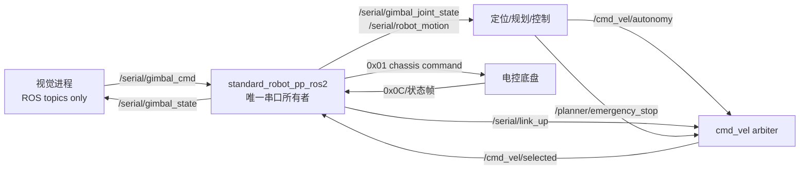

# 2027 串口融合与隧道仿真移植方案

> 日期：2026-10-17　状态：方案实施回填；串口、视觉 ROS 2 桥、MuJoCo 2027、Gazebo 2027 world transport/仿真 TF 和 GICP 重定位已验证，Gazebo 红框导航与物理接触仍待验收
> 目标：① 让视觉、导航和底盘共用一个串口所有者，完成整车串口收发；② 接入新车尺寸与 `2027_map/` 隧道仿真；③ 让导航在进入隧道前按 ESDF 对准 yaw，并始终用 0.571 m 那一面通过。

本方案的交付结果是一个可回归的闭环，而不是“串口话题存在”或“车辆绕过隧道”。视觉进程不再直接打开 `/dev/ttyACM*`；串口节点统一负责底盘、云台和链路健康；规划器必须让车体足迹实际穿过隧道多边形，并在入口前完成定向。

### 0.1 本轮目标与 Definition of Done

| 目标 | 完成条件 | 证据类型 |
| --- | --- | --- |
| 整车串口收发 | `standard_robot_pp_ros2` 是唯一串口读写者；视觉通过 `/serial/gimbal_state`、`/serial/gimbal_cmd` 接入；底盘指令仍由 `/cmd_vel/selected` 进入；链路断开时底盘速度为零、云台命令超时停发 | 源码 + 单测 + 隔离串口/PTY 回环 |
| 视觉导航闭环 | 视觉状态上行、视觉命令下行、导航速度下行和底盘状态上行均能在同一 ROS graph 中各找到唯一 owner；无旧视觉串口实例 | `ros2 topic info -v` + 日志 + 端到端回环 |
| 隧道可通过 | 规划路径穿过隧道 polygon；进入前 yaw 误差不超过 `yaw_tunnel_yaw_tolerance`；全程 footprint gate 通过；MuJoCo 顶板产生零物理接触 | 单测 + 无 viewer MuJoCo + `evaluate_tunnel_pass.py` |
| 故障安全 | 串口失联、地图过期、隧道对准不可行、MPC 失败均输出确定性零速度；恢复链路不会复活旧 reference | 故障注入日志 + `/planner/emergency_stop`、`/cmd_vel_mpc`、`/motion_control` |

本轮不把“编译通过、topic 存在、局部轨迹生成”写成 DoD。硬件波特率、协议字节表、雷达外参和隧道实际宽度仍需实测或由电控/机械确认。

### 0.2 目标闭环与唯一所有权



接口边界必须同时记录 frame、时间戳、单位、超时和 fallback。导航速度是车体系 `[vx, vy, wz]`；视觉云台角度和角速度统一为 rad；ROS 话题与串口帧之间不允许再出现第二个串口写入者。

### 0.3 当前状态标记

| 状态 | 当前事实 | 结论 |
| --- | --- | --- |
| 已核实 | `standard_robot_pp_ros2` 已拥有底盘串口收发、执行授权门和断连归零；默认底盘输入为 `/cmd_vel/selected` | 可作为融合宿主，不能整包覆盖 |
| 已核实 | ROS 2 条件编译下 `src/sp_vision25` 使用 `GimbalTopicBridge`，通过 `/serial/gimbal_state` 和 `/serial/gimbal_cmd` 接入；非 ROS 2 旧可执行文件仍保留直连串口兼容路径 | ROS 2 视觉入口不得与串口宿主并行启动 |
| 已核实 | `standard_robot_pp_ros2` 发布 `/serial/link_up`，并在串口断开时归零底盘/云台输出 | 现场仍需用真实电控帧确认协议字节与波特率 |
| 已核实 | MuJoCo 已提供 `rmuc_2027_mujoco.launch.py`、`tunnel_2027` profile、顶板 box 和 yaw 对齐算法；Gazebo 已提供 `rmuc_2027_gazebo.launch.py` 与同风格 RViz | MuJoCo 隧道回归通过；Gazebo 完整闭环等待 LiDAR 渲染修复 |
| 待实测 | 电控对 `0x01`、`0x0C`、`0x0E`、`0x02` 的最终长度、波特率和失联语义 | 未拿到字节级回环前不能宣称整车接收/发送通过 |

## 0. 证据边界

| 标记 | 含义 |
| --- | --- |
| 已核实 | 本轮读过源码或跑过脚本 |
| 推断 | 由已核实数据推出，未经运行验证 |
| 待实测 | 必须量实车或问电控/机械 |

本轮核实了：两版串口包的文件级差异、新增包结构体、`fromVector` 越界、两线程并发写串口、波特率、`/serial/link_up` 无发布者、视觉仍直连串口；2027 STL/PCD 的三角形数、包围盒、单位、PCD 头与背面点比例；MuJoCo hfield 生成器的顶梁处理。

待实测（填完再动 TF 与车模）：

| 符号 | 含义 | 当前仓库值 |
| --- | --- | --- |
| `h_g` | `gimbal_yaw_odom` 离地高度 | URDF 0.20 / loam 0.15 / MuJoCo 0.18，三处不一致 |
| `z_L` | 雷达光心离地高度及完整位姿 | 实车静态 TF 推算约 0.475，MuJoCo 约 0.51 |
| `c` | 底盘下表面离地高度 | MuJoCo 0.08 |
| `r` | 轮半径 | 0.0425 |
| 质量 | 整车质量 | MuJoCo 23 kg |

硬约束（用户确认）：

- 整车高 0.242 m **含雷达**，雷达嵌在车体内，所以 `z_L < 0.242`，任何碰撞体顶面不超过离地 0.242 m。
- **高度不做可行性判断**：车体高度保证能过隧道，规划只需让顶板不进规划栅格，不比较顶板高度与车高。
- **隧道只用 0.571 m 那一面通过**：0.571 m 的那条边垂直于隧道走向、正对隧道，即车体 $\pm y$ 轴沿隧道轴线，通过截面宽 0.571 m。0.581 m 那一面不考虑。yaw 由 ESDF 估计的隧道轴线决定，见第 4 节。
- **必须具备通过能力**：只要隧道宽度满足 4.1 的下限，规划不能以各向同性净空为由拒绝进入。

---

## 1. 串口融合移植

### 1.1 结论：不能整包覆盖

参考版 `参考/ATS_Nav_Ven/src/standard_robot_pp_ros2` 是旧 PolarBear 基线（`pb_rm_interfaces`）加两个视觉文件。整包覆盖会丢掉当前版的：

- 执行授权门 `cmd_vel_authorization.hpp`、断连归零、重连不自动恢复授权；
- `cmd_vel_topic`（默认 `/cmd_vel/selected`）、`robot_mode_topic`、零速保持、看门狗；
- 三轴 `ReceiveJointState`（big_yaw / small_yaw / pitch）与旧两轴兼容；
- `GimbalYawStatus` 发布器、`test/` 下全部单测；
- `ats_rm_interfaces` 命名，以及 `speed_vector.mode` 姿态字段。

做法：以当前版为底，只移植视觉相关增量。

### 1.2 文件级差异（已核实，`diff -rq`）

| 文件 | 处理 |
| --- | --- |
| `include/.../packet_typedef_addon.hpp`（仅参考版有） | 原样拷入 |
| `include/.../gimbal_bridge_addon.hpp`（仅参考版有） | 拷 `参考/ATS_Nav_Ven/Start/nav_bridge/` 下的 UTF-8 版，src 版注释是 GBK 乱码；再按 1.4 修 4 处 |
| `include/.../2025_robot_decision.hpp`、`src/2025_robot_decision.cpp` | 旧决策代码，与融合无关，不迁 |
| `standard_robot_pp_ros2.hpp` / `.cpp` | 手工合并，只加视觉成员、构造注入与 `0x0E` 分支 |
| `packet_typedef.hpp` | 保留当前版；参考版删掉了三轴 joint state 与 `mode` 字段，不能用 |
| `gimbal_manager.*`、`CMakeLists.txt`、`package.xml`、`launch`、`README.md` | 保留当前版；`package.xml` 已有 `std_msgs` 则不必改 |
| `config/standard_robot_pp_ros2.yaml` | 只合 `baud_rate`（见 1.6） |
| `test/`、`cmd_vel_authorization.hpp`、`gimbal_yaw_status_*`（仅当前版有） | 全部保留 |

### 1.3 新增协议（已核实，`packet_typedef_addon.hpp`）

帧头沿用 `HeaderFrame{sof,len,id,crc8}`（4 B），`len` = 数据段长度 = `sizeof(包) - 6`。

| ID | 方向 | 总长 | 数据段（packed，小端） |
| --- | --- | --- | --- |
| `0x0E` `ID_GIMBAL_STATE` | 电控→上位机 | 49 B | `time_stamp u32` + `mode u8, q[4] f32 (wxyz), yaw, yaw_vel, pitch, pitch_vel, bullet_speed f32, bullet_count u16` + `crc16` |
| `0x02` `ID_GIMBAL_CMD` | 上位机→电控 | 35 B | `time_stamp u32` + `mode u8 (0 不控/1 控不射/2 控且射), yaw, yaw_vel, yaw_acc, pitch, pitch_vel, pitch_acc f32` + `crc16` |

`0x0E.mode`：0 空闲、1 自瞄、2 小符、3 大符、4 导航接管、5 冲突降级、6 预留。角度一律 rad。

ROS 话题（相对名，节点无命名空间时即 `/serial/...`）：

| 话题 | 类型 | 方向 | 布局 |
| --- | --- | --- | --- |
| `serial/gimbal_state` | `std_msgs/Float64MultiArray` | 桥→视觉 | 11 元：`[mode, qw, qx, qy, qz, yaw, yaw_vel, pitch, pitch_vel, bullet_speed, bullet_count]` |
| `serial/gimbal_cmd` | `std_msgs/Float64MultiArray` | 视觉→桥 | 7 元：`[mode, yaw, yaw_vel, yaw_acc, pitch, pitch_vel, pitch_acc]`，超过 100 ms 无新帧则停发 |

发送线程独立于底盘发送线程，5 ms 周期。

### 1.4 移植步骤（`src/standard_robot_pp_ros2`）

**步骤 1：拷入协议头。** `Start/nav_bridge/` 与 `src/` 下的 `packet_typedef_addon.hpp` 逐字节相同（已 `cmp`）。

```bash
cd /home/ats/ATS_2026_snetry_test
cp 参考/ATS_Nav_Ven/Start/nav_bridge/packet_typedef_addon.hpp \
   src/standard_robot_pp_ros2/include/standard_robot_pp_ros2/
```

`gimbal_bridge_addon.hpp` 不直接拷：`src/` 版逻辑较新（构造时注入发送函数、100 ms 失联停发、含 `crc8_crc16.hpp`），但注释乱码；`Start/` 版注释正常但逻辑旧。按步骤 2 的完整文件新建。

**步骤 2：新建 `gimbal_bridge_addon.hpp`（含 4 处修正）。**

参考版的问题与修正：

| # | 问题（已核实） | 位置 | 修正 |
| --- | --- | --- | --- |
| 1 | `fromVector<T>` 按 `data.size()` 拷入 `sizeof(T)` 的栈对象，`len` 偏大即栈溢出 | 参考版 `standard_robot_pp_ros2.cpp:397-399`、`packet_typedef.hpp:404` | `0x0E` 分支先校验 `len == sizeof(ReceiveGimbalStateData) - 6` |
| 2 | 云台线程与底盘发送线程同时调 `port()->send()`，无锁，帧会交织 | 参考版 `.cpp:22-25` 与 `:743` | 宿主节点加 `serial_write_mutex_`，两处发送都持锁 |
| 3 | `mode=2`（开火）不受断连/急停约束 | `gimbal_bridge_addon.hpp:101-120` | 注入 `fire_permitted` 回调，不放行时把 2 降为 1 |
| 4 | 断连时直接 `send` 抛异常只置 `is_usb_ok_=false`，绕过 `setSerialLinkState` | 参考版 `.cpp:22-29` | 由宿主的发送函数统一处理，失败调 `setSerialLinkState(false)` |

完整文件（`src/standard_robot_pp_ros2/include/standard_robot_pp_ros2/gimbal_bridge_addon.hpp`）：

```cpp
#ifndef STANDARD_ROBOT_PP_ROS2__GIMBAL_BRIDGE_ADDON_HPP_
#define STANDARD_ROBOT_PP_ROS2__GIMBAL_BRIDGE_ADDON_HPP_

// 串口融合：视觉 <-> 电控的话题桥。串口唯一所有者仍是 StandardRobotPpRos2Node，
// 本类只负责组包/解包，真正的写串口、加锁和断连处理由宿主注入的 serial_send_fn 完成。

#include <atomic>
#include <chrono>
#include <cmath>
#include <functional>
#include <mutex>
#include <thread>
#include <vector>

#include "rclcpp/rclcpp.hpp"
#include "standard_robot_pp_ros2/crc8_crc16.hpp"
#include "standard_robot_pp_ros2/packet_typedef_addon.hpp"
#include "std_msgs/msg/float64_multi_array.hpp"

namespace standard_robot_pp_ros2
{

class GimbalBridgeAddon
{
public:
  // 与协议规格书 3.2 电控端 >=100ms 失联语义对齐：超时停发，不重发旧帧。
  static constexpr int kGimbalCmdTimeoutMs = 100;
  static constexpr uint8_t kModeTrackNoFire = 1;
  static constexpr uint8_t kModeTrackAndFire = 2;

  using SerialSendFn = std::function<void(const std::vector<uint8_t> &)>;
  // 返回 false 时禁止开火，mode=2 降级为 mode=1（仍跟踪，不发弹）。
  using FirePermittedFn = std::function<bool()>;

  // 两个回调必须在构造时注入：发送线程在构造函数里启动，事后再赋值是数据竞争。
  GimbalBridgeAddon(
    rclcpp::Node & node, SerialSendFn serial_send_fn, FirePermittedFn fire_permitted_fn)
  : node_(node),
    serial_send_fn_(std::move(serial_send_fn)),
    fire_permitted_fn_(std::move(fire_permitted_fn)),
    gimbal_state_pub_(
      node.create_publisher<std_msgs::msg::Float64MultiArray>("serial/gimbal_state", 10)),
    gimbal_cmd_sub_(node.create_subscription<std_msgs::msg::Float64MultiArray>(
      "serial/gimbal_cmd", 10,
      [this](const std_msgs::msg::Float64MultiArray::SharedPtr msg) { onGimbalCmd(*msg); }))
  {
    gimbal_cmd_send_thread_ = std::thread([this]() { gimbalCmdSendLoop(); });
  }

  ~GimbalBridgeAddon()
  {
    gimbal_cmd_running_ = false;
    if (gimbal_cmd_send_thread_.joinable()) gimbal_cmd_send_thread_.join();
  }

  GimbalBridgeAddon(const GimbalBridgeAddon &) = delete;
  GimbalBridgeAddon & operator=(const GimbalBridgeAddon &) = delete;

  // receiveData() 的 ID_GIMBAL_STATE 分支调用；调用方已校验 len。
  void publishGimbalState(const ReceiveGimbalStateData & d)
  {
    std_msgs::msg::Float64MultiArray msg;
    msg.data.reserve(11);
    msg.data.push_back(static_cast<double>(d.data.mode));
    for (int i = 0; i < 4; ++i) msg.data.push_back(static_cast<double>(d.data.q[i]));
    msg.data.push_back(static_cast<double>(d.data.yaw));
    msg.data.push_back(static_cast<double>(d.data.yaw_vel));
    msg.data.push_back(static_cast<double>(d.data.pitch));
    msg.data.push_back(static_cast<double>(d.data.pitch_vel));
    msg.data.push_back(static_cast<double>(d.data.bullet_speed));
    msg.data.push_back(static_cast<double>(d.data.bullet_count));
    gimbal_state_pub_->publish(msg);
  }

private:
  void onGimbalCmd(const std_msgs::msg::Float64MultiArray & msg)
  {
    // 维度错误或含 NaN/Inf 的帧直接丢弃，不刷新时间戳，让超时逻辑自然停发。
    if (msg.data.size() != 7) return;
    for (double v : msg.data) {
      if (!std::isfinite(v)) return;
    }
    std::lock_guard<std::mutex> lock(gimbal_cmd_mutex_);
    latest_gimbal_cmd_ = msg;
    latest_gimbal_cmd_time_ = std::chrono::steady_clock::now();
  }

  void gimbalCmdSendLoop()
  {
    SendGimbalCmdData pkt{};
    pkt.frame_header.sof = SOF_SEND;
    pkt.frame_header.id = ID_GIMBAL_CMD;
    pkt.frame_header.len = sizeof(SendGimbalCmdData) - 6;

    const auto period = std::chrono::milliseconds(5);
    auto next_tick = std::chrono::steady_clock::now();
    while (rclcpp::ok() && gimbal_cmd_running_) {
      next_tick += period;
      bool has_cmd = false;
      {
        std::lock_guard<std::mutex> lock(gimbal_cmd_mutex_);
        const auto now = std::chrono::steady_clock::now();
        const bool fresh = latest_gimbal_cmd_time_ != std::chrono::steady_clock::time_point{} &&
                           now - latest_gimbal_cmd_time_ <
                             std::chrono::milliseconds(kGimbalCmdTimeoutMs);
        if (fresh) {
          const auto & d = latest_gimbal_cmd_.data;
          has_cmd = true;
          pkt.data.mode = static_cast<uint8_t>(d[0]);
          pkt.data.yaw = static_cast<float>(d[1]);
          pkt.data.yaw_vel = static_cast<float>(d[2]);
          pkt.data.yaw_acc = static_cast<float>(d[3]);
          pkt.data.pitch = static_cast<float>(d[4]);
          pkt.data.pitch_vel = static_cast<float>(d[5]);
          pkt.data.pitch_acc = static_cast<float>(d[6]);
        }
      }
      if (has_cmd) {
        // 开火门：只在宿主允许时透传 mode=2；mode 越界（>2）按 0 不控制处理。
        if (pkt.data.mode > kModeTrackAndFire) pkt.data.mode = 0;
        if (pkt.data.mode == kModeTrackAndFire && !(fire_permitted_fn_ && fire_permitted_fn_())) {
          pkt.data.mode = kModeTrackNoFire;
        }
        pkt.time_stamp = static_cast<uint32_t>(node_.now().nanoseconds() / 1000000ULL);
        crc8::append_CRC8_check_sum(reinterpret_cast<uint8_t *>(&pkt), sizeof(HeaderFrame));
        crc16::append_CRC16_check_sum(reinterpret_cast<uint8_t *>(&pkt), sizeof(SendGimbalCmdData));
        if (serial_send_fn_) serial_send_fn_(toVector(pkt));
      }
      std::this_thread::sleep_until(next_tick);
    }
  }

  rclcpp::Node & node_;
  SerialSendFn serial_send_fn_;
  FirePermittedFn fire_permitted_fn_;
  rclcpp::Publisher<std_msgs::msg::Float64MultiArray>::SharedPtr gimbal_state_pub_;
  rclcpp::Subscription<std_msgs::msg::Float64MultiArray>::SharedPtr gimbal_cmd_sub_;

  std::mutex gimbal_cmd_mutex_;
  std_msgs::msg::Float64MultiArray latest_gimbal_cmd_;
  std::chrono::steady_clock::time_point latest_gimbal_cmd_time_{};
  std::thread gimbal_cmd_send_thread_;
  std::atomic<bool> gimbal_cmd_running_{true};
};

}  // namespace standard_robot_pp_ros2

#endif  // STANDARD_ROBOT_PP_ROS2__GIMBAL_BRIDGE_ADDON_HPP_
```

线程在构造函数体里才启动，此时所有成员都已初始化完，成员声明顺序不影响安全。

**步骤 3：宿主头文件 `standard_robot_pp_ros2.hpp`。**

```cpp
#include "standard_robot_pp_ros2/gimbal_bridge_addon.hpp"   // 新增 include

// private 成员区：放在 serial_driver_、is_usb_ok_、cmd_vel_gate_、send_cmd_mutex_ 等
// 成员【之后】声明（成员按声明顺序构造，桥的线程一启动就可能调用这些成员）。
std::mutex serial_write_mutex_;               // 两个发送线程共用
std::atomic<bool> fire_inhibited_{true};      // 断连/急停/未授权时为 true
bool enable_gimbal_bridge_ = true;
std::unique_ptr<GimbalBridgeAddon> gimbal_bridge_;   // 用指针，参数读完再构造

void sendSerialFrame(const std::vector<uint8_t> & frame);  // 唯一写串口入口
```

用 `std::unique_ptr` 而不是参考版的值成员：参考版在初始化列表里构造桥，线程在参数声明、串口打开之前就跑起来了；改成在构造函数末尾、`serialPortProtect` 线程启动之前 `make_unique`。

**步骤 4：宿主 `standard_robot_pp_ros2.cpp`，共 5 处。**

(a) 唯一写串口入口。断连时不写，失败走 `setSerialLinkState(false)`，保证断连归零语义只有一个实现：

```cpp
void StandardRobotPpRos2Node::sendSerialFrame(const std::vector<uint8_t> & frame)
{
  if (!is_usb_ok_) return;
  std::lock_guard<std::mutex> lock(serial_write_mutex_);
  serial_driver_->port()->send(frame);   // 异常交给调用方处理
}
```

(b) 底盘发送线程（当前 `.cpp:1054`）把 `serial_driver_->port()->send(send_data);` 换成 `sendSerialFrame(send_data);`，外层 `try/catch` 与 `setSerialLinkState(false)` 保持不变。

(c) 构造函数末尾、启动 `serialPortProtect` / receive / send 线程之前：

```cpp
enable_gimbal_bridge_ = declare_parameter("enable_gimbal_bridge", true);
if (enable_gimbal_bridge_) {
  gimbal_bridge_ = std::make_unique<GimbalBridgeAddon>(
    *this,
    [this](const std::vector<uint8_t> & frame) {
      try {
        sendSerialFrame(frame);
      } catch (const std::exception & ex) {
        RCLCPP_ERROR(get_logger(), "Error sending gimbal cmd: %s", ex.what());
        setSerialLinkState(false);
      }
    },
    [this]() { return !fire_inhibited_.load(); });
}
```

析构函数开头先 `gimbal_bridge_.reset();`，确保云台线程在串口对象销毁前退出。

(d) `receiveData()` 的 switch，在 `case ID_BUFF`（当前 `.cpp:620`）后加：

```cpp
case ID_GIMBAL_STATE: {
  if (header_frame.len != sizeof(ReceiveGimbalStateData) - sizeof(HeaderFrame) - 2U) {
    RCLCPP_WARN_THROTTLE(get_logger(), *get_clock(), 1000,
      "Ignore ID_GIMBAL_STATE with len %u, expected %zu", header_frame.len,
      sizeof(ReceiveGimbalStateData) - sizeof(HeaderFrame) - 2U);
    break;
  }
  if (gimbal_bridge_) {
    gimbal_bridge_->publishGimbalState(fromVector<ReceiveGimbalStateData>(data_buf));
  }
} break;
```

更稳的做法是在 `switch` 之前统一加一道 `data_buf.size() <= 64` 的上限检查。当前版只有 `ID_JOINT_STATE` 分支校验了 `len`，其余分支同样依赖 `fromVector` 不越界。

(e) 开火门与 `/serial/link_up` 心跳。

`ats_cmd_vel_arbiter` 订阅 `/serial/link_up`（`std_msgs/Bool`，`reliable + transient_local`，`cmd_vel_arbiter_node.cpp:87-88`），实车参数 `require_serial_link: true`、`link_timeout_ms: 300`（`node_params.yaml:1085-1089`）。**全仓库没有任何节点发布它（已 grep 核实）**，所以实车上 arbiter 会一直输出零速。这和视觉融合无关，但同一次改串口节点时顺手补上：

```cpp
// 成员
rclcpp::Publisher<std_msgs::msg::Bool>::SharedPtr link_up_pub_;
rclcpp::TimerBase::SharedPtr link_up_timer_;
bool emergency_stop_active_ = false;   // 在已有 emergencyStopCallback 里赋值

// 构造函数
link_up_pub_ = create_publisher<std_msgs::msg::Bool>(
  "/serial/link_up", rclcpp::QoS(1).reliable().transient_local());
link_up_timer_ = create_wall_timer(std::chrono::milliseconds(50), [this]() {
  std_msgs::msg::Bool m;
  m.data = is_usb_ok_.load();
  link_up_pub_->publish(m);          // 20 Hz 心跳，必须快于 link_timeout_ms=300
  // 开火门：断连一定禁射；急停是否禁射由参数决定（团队定，默认禁射）
  fire_inhibited_ = !m.data || (fire_inhibit_on_emergency_stop_ && emergency_stop_active_);
});
```

需要团队拍板的一点：比赛中导航未授权（车停着）时视觉照常开火是合理的，所以开火门**不**绑定执行授权，只绑定断连与急停。如果电控侧已经有失联停射，可以把 `fire_inhibit_on_emergency_stop` 设为 `false`。

### 1.5 参数（`config/standard_robot_pp_ros2.yaml` 与 `src/ats_sentry_bringup/params/node_params.yaml:13` 两处）

```yaml
baud_rate: 921600                     # 当前 115200；参考版 yaml 与规格书都是 921600
enable_gimbal_bridge: true
fire_inhibit_on_emergency_stop: true
```

波特率必须和电控固件一起改，先确认固件版本再改。

### 1.6 视觉侧（`src/sp_vision25`）

现状（已核实）：`io::Gimbal` 自己开串口，`configs/sentry.yaml:120` 为 `com_port: "/dev/ttyACM1"`；哨兵入口 `src/sentry.cpp:37` 与调试入口 `src/auto_aim_debug_mpc.cpp:157` 都是 `io::Gimbal gimbal(config_path);`。队友只给了 `auto_aim_debug_mpc.cpp` 的 diff。

步骤：

1. 拷 `参考/ATS_Nav_Ven/Start/vision_bridge/gimbal_topic_bridge.{hpp,cpp}` 到 `src/sp_vision25/io/ros2/`，加进 `io/CMakeLists.txt` 的源文件列表，链接 `rclcpp`、`std_msgs`。`CMakeLists.txt:23-39` 现在是 `QUIET` 可选查找 ROS；桥接要求 ROS，必须在找到 `rclcpp` 时才编译，否则编译期报错，不要静默回退到串口。
2. 对 `sentry.cpp` 做与 diff 相同的 3 处改动：加 `#include "io/ros2/gimbal_topic_bridge.hpp"`，`io::Gimbal gimbal(config_path);` 改为 `io::GimbalTopicBridge gimbal;`。`sentry.cpp` 本身没有 `rclcpp` 调用；桥的构造函数在 `!rclcpp::ok()` 时自行 `rclcpp::init(0, nullptr)` 并起 spin 线程（`gimbal_topic_bridge.cpp:13,25`），所以 `main` 不用改，但这样拿不到 `--ros-args`，命名空间和 remap 无法从命令行传入。`GimbalTopicBridge` 保持 `q()/state()/mode()/send()` 接口兼容，主循环其余代码不动。
3. 视觉进程不能再打开 `/dev/ttyACM*`。`sentry.yaml` 的 `com_port` 保留但加注释"融合后不使用"，或在 `io::Gimbal` 构造里打印弃用告警。
4. 单位：协议规定 rad，但 `auto_aim_debug_mpc.cpp:441` 有 `source_is_degree` 自动判别逻辑。接入后跑一次，确认日志里 `gimbal_source_unit` 是 `rad`。
5. 话题对接：视觉与串口节点要在同一命名空间下，或都用绝对名 `/serial/gimbal_state`、`/serial/gimbal_cmd`。启动后用 `ros2 topic info -v` 确认 publisher / subscriber 各为 1。

### 1.7 测试

新增 `test/test_gimbal_bridge_addon.cpp`（`ament_add_gtest`，与现有 `CMakeLists.txt:66-70` 同风格），覆盖：

| 用例 | 断言 |
| --- | --- |
| 包长 | `sizeof(ReceiveGimbalStateData)==49`、`sizeof(SendGimbalCmdData)==35`（头文件里已有 `static_assert`，测试再锁一次 `len` 字段） |
| CRC | 组出的 `0x02` 帧 `verify_CRC8`、`verify_CRC16` 都通过 |
| 维度/NaN | 6 元或含 NaN 的 `gimbal_cmd` 不发任何帧 |
| 超时 | 最后一帧后 >100 ms 不再发帧 |
| 开火门 | `fire_permitted=false` 时 `mode=2` 发出为 `1`；`mode=7` 发出为 `0` |
| 长度防护 | `len` 偏大的 `0x0E` 被丢弃，不调用 `publishGimbalState` |

测试里把 `serial_send_fn` 注入成往 `std::vector` 里收集帧的 lambda，不需要真串口。现有 `test_cmd_vel_authorization` 与 `test_gimbal_yaw_status_logic` 必须保持全绿。

```bash
MAKEFLAGS=-j1 colcon build --base-paths src --packages-select standard_robot_pp_ros2 sp_vision25 --parallel-workers 1
colcon test --base-paths src --packages-select standard_robot_pp_ros2
colcon test-result --test-result-base build/standard_robot_pp_ros2 --verbose
```

### 1.8 硬件联调前必须和电控确认

| 项 | 上位机当前值（已核实） | 规格书/参考版 | 说明 |
| --- | --- | --- | --- |
| `0x01` 底盘指令包 | 54 B（`speed_vector` 内多一个 4 B `enum mode`） | 50 B | 固件必须按 54 B 解析；`enum` 在 packed 结构里占 4 B，建议改成 `uint8_t` 并与电控同步改 |
| `0x0C` joint state | 22 B（三轴 big_yaw/small_yaw/pitch），兼容 18 B 两轴 | 18 B 两轴 | 规格书过时 |
| 波特率 | 115200 | 921600 | 两边同时改 |
| `0x0E` / `0x02` | 新增 | 49 B / 35 B | 固件需实现；电控侧 ≥100 ms 失联要停止视觉控制 |
| 开火失联保护 | — | 未写明 | 决定 `fire_inhibit_on_emergency_stop` 默认值 |

### 1.9 整车串口闭环验收

串口桥完成后按以下顺序验收。每个阶段失败都停止向下一阶段推进，避免用导航话题存在掩盖串口协议错误。

| 阶段 | 操作 | 必须观察到的结果 |
| --- | --- | --- |
| 进程唯一性 | 启动串口节点和视觉节点，检查视觉进程打开的设备句柄；执行 `lsof /dev/ttyACM*` | 只有 `standard_robot_pp_ros2` 持有串口设备；视觉进程无串口句柄 |
| ROS 图 | `ros2 topic info -v /serial/gimbal_state`、`/serial/gimbal_cmd`、`/cmd_vel/selected`、`/serial/link_up` | 云台状态/命令各 1 个桥接 owner；底盘速度只有 arbiter 输出；`/serial/link_up` 只有串口宿主发布 |
| 视觉上行 | 电控或 PTY 回放合法 `0x0E` 帧 | `/serial/gimbal_state` 11 个元素、rad 单位、时间戳单调；错误长度/CRC 帧不发布 |
| 视觉下行 | 发布 7 元 `/serial/gimbal_cmd`，覆盖 mode 0/1/2、NaN、超时 | 合法帧按 5 ms 周期发出；NaN/维度错误丢弃；超过 100 ms 停发；禁止开火时 mode 2 降为 1 |
| 底盘下行 | 发布带授权的 `/cmd_vel/selected`，检查电控/PTY 收到 `0x01` | 车体系 `[vx, vy, wz]` 的字节值、长度和 CRC 与电控字节表一致；发送帧不交织 |
| 断链恢复 | 关闭串口或注入发送异常，再恢复设备 | `link_up=false -> emergency_stop=true -> /cmd_vel_mpc=0 -> /motion_control=0`；恢复后必须有新授权/新 reference 才能运动 |

建议新增 `src/standard_robot_pp_ros2/test/test_serial_visual_loopback.py`（或等价 GTest）覆盖 PTY/注入发送函数，并把电控最终字节表保存为测试 fixture。仅用 `Float64MultiArray` 传输时，必须在桥接回调中锁定长度、有限值、单位和模式范围；后续若改自定义 ROS message，应保持串口帧不变并单独提交接口迁移。

硬件验收记录至少保留：串口设备名、波特率、固件版本、发送/接收帧计数、CRC 错误数、最大往返延迟、断链到零速延迟和恢复后旧命令未复活的证据。

---

## 2. 新车辆参数

输入：长 0.571（x）、宽 0.58131（y）、高 0.242（含雷达）。

推导：
- 外接圆半径 $\sqrt{0.2855^2+0.29066^2}=0.4074$ m（旧 0.58×0.58 为 0.4101）；内切半宽 0.2855 m。平面尺寸只比现状小几毫米，**由外接圆推出的净空参数不用动**。

文件缩写：NP = `src/ats_sentry_bringup/params/node_params.yaml`，MJ = `src/sim/ats_mujoco_sim/config/rmuc_2025_navigation.yaml`，GZ = `src/sim/gazebo_simulator/rmu_gazebo_simulator/launch/ats_gazebo_nav.launch.py`。行号来自本轮调查，改之前用 `rg` 再定位一次。

### 2.1 footprint（可以立即改）

| 参数 | 位置 | 当前 | 新值 |
| --- | --- | --- | --- |
| `footprint_length/width`（adapter / minco / goal_manager） | NP:897-898、1010-1011、1070-1071 | 0.58 / 0.58 | 0.571 / 0.581 |
| 同上 | MJ:35-36、118-119、240-241 | 0.58 / 0.58 | 0.571 / 0.581 |
| 同上 | GZ:1163-1164、1213-1214 | 0.58 / **0.44**（为窄走廊故意收窄） | 0.571 / 0.581，窄走廊可能重新失败 |
| 包级 yaml | `ats_rog_map_adapter/config/rog_map_ground_planning.yaml:51-52`、`minco_planner/config/minco_planner_reality.yaml:88-89`、`ats_goal_manager/config/*.yaml` | 0.58 | 0.571 / 0.581 |
| C++ 默认值 | `footprint_safety_checker.hpp:16-18`、`minco_planner_node.hpp:180-182`、`minco_joint_optimizer.hpp:59-61`、`minco_trajectory_optimizer.hpp:110-112`、`ats_rog_map_adapter_node.cpp:120-121`、`ats_goal_manager_node.cpp:340-344` | 0.58 | 0.571 / 0.581 |
| **过时** C++ 默认值 | `planning_snapshot_safety.hpp:19-21`、`ats_rog_map_adapter_node.cpp:910-912` | 0.70 / 0.55 | 0.571 / 0.581 |
| 脚本 | `scripts/footprint_evaluator.py:47-49`；`scripts/evaluate_mujoco_unsafe_trajectory.py:245-246`（半长写死 0.40/0.325） | | 0.571/0.581；半长 0.3055/0.3107（含 MJ margin 0.02） |
| 测试 | `test_rmuc_2025_scene.py:117-119`；`test_mujoco_minco_mpc_chain.sh:1507-1509` 净空下限 0.341 | | 同步；下限按新内切半宽重算 |
| 规范 | `AGENTS.md` 6.1 节"0.70 x 0.55 m" | | 改为 0.571 x 0.581 |

开阔区不改：`jps_safe_distance` 0.54、`esdf_obstacle_clearance` 0.45、`joint_center_clearance` 0.54、`body_yaw_follow_clearance` 0.55、BT `follow_candidate_clearance_radius_m` 0.45。这些按外接圆设计，在隧道里一定不满足（隧道中心净空约为宽度的一半），隧道段走第 4 节的定向净空逻辑。

### 2.2 轮距

实车轮心到底盘中心的半轴偏置是 ±0.270 m（`wheel_base_x/y`，见 `ats_swerve_mpc_reality.yaml`；用户 2026-10-29 确认）。MPC、MINCO、MuJoCo 的所有车模与运动学、Gazebo 的 xmacro 取值与它一致，不需要改。

### 2.3 高度、雷达与车模（量完 `h_g`、`z_L`、`c`、`r` 后一起改）

现状三处互相矛盾（已调查）：

| 量 | URDF/xmacro | 实车 / Gazebo 静态 TF | MuJoCo |
| --- | --- | --- | --- |
| `gimbal_yaw_odom` 离地 | 0.20（chassis 0.10 + gimbal_yaw 0.10） | loam `base_frame_height` 0.15（NP:332） | 根 body 0.18 |
| 雷达 | `ats_sentry_robot.sdf.xmacro:59` `-0.2 0 0 0 0 -61°` | `bringup.launch.py:109-116`、GZ:466-476 `-0.1 0.245 0.325 75° 0 -161°`，离地约 0.475 | `lidar_link` pos `-0.100 0.245 0.325`，离地约 0.51 |
| 车体碰撞顶 | 离地 0.165 | — | 离地 0.31 |

按"雷达嵌在 0.242 m 车体内"，表中所有雷达高度和 MuJoCo 碰撞顶都超出包络，必须改。注释声称静态 TF 与 xmacro 一致，实际不一致（xmacro 在 `ed293ca` 改过，launch 没跟）。

改法（单一事实源）：

1. 以实测为准写进 `ats_sentry_robot.sdf.xmacro`：`chassis_length 0.571`、`chassis_width 0.58131`、`robot_total_height 0.242`（XM:19-21，目前定义了却没人引用）、`chassis_height`、`gimbal_yaw_height` 使二者之和 = `h_g`、livox 位姿使 `z_L` 为实测值。
2. `bringup.launch.py:109-116` 与 GZ:466-476 的雷达静态 TF 改成与 xmacro 相同的数，或者删掉静态 TF、改由 `robot_state_publisher` 发布（二选一，避免 `front_livox_joint` 与静态 TF 重复发布同一条边）。
3. loam `base_frame_height`（NP:332）= `h_g`。这个值错了会让所有"绝对高度带"整体平移。
4. 雷达在车体内，车体会挡住部分视场：
   - Point-LIO `blind`（NP:278，当前 0.3）≥ 雷达到最远车体点的距离；
   - ROG `self_filter_radius`（NP:792，当前 0.45）改为约 0.42（外接圆 0.407 + 0.01）。它是 2D 圆柱，隧道侧墙离车中心不到 0.42 m 时也会被删，长期应改成定向矩形自滤波。

MuJoCo 车模（`src/sim/ats_mujoco_sim/models/` 下 `swerve.xml`、`swerve_chassis.xml`、`rmuc_2025_swerve.xml`、`rmuc_2026_swerve.xml` 四份副本，新建 `rmuc_2027_swerve.xml` 时只改这一份）：

| 元素 | 当前 | 新值 |
| --- | --- | --- |
| 根 body `base_link` z | 0.18 | `h_g` |
| `base_collision` box | size `0.290 0.290 0.115`、pos z `0.015`（离地 0.08–0.31） | size `0.2855 0.29066 (0.242-c)/2`，pos z `(0.242+c)/2 - h_g` |
| `lidar_link` pos | `-0.100 0.245 0.325` | 实测，且 `h_g + z_local + 光心偏移 < 0.242` |
| `steer_link` | `(±0.270, ±0.270, -0.1375)` | `(±0.270, ±0.270, -(h_g - r))`（x、y 不变） |
| ToF 安装 y | ±0.276 | ±(0.29066 − 0.014) |
| 惯量 | 23 kg，diag 0.808/1.268/1.584 | 质量实测；23 kg、0.571×0.581×0.162 盒子粗算约 0.698/0.675/1.273 |
| `sim_node.py:788-793` tof footprint | 0.58/0.58，z −0.10/0.13 | 0.571/0.581，z `c-h_g` / `0.242-h_g` |
| `sim_node.py:812,818` | 0.18 | `h_g` |

**碰撞体顶面就是过隧道判据**，所以只能用一个顶面 = 离地 0.242 的 box，不要再叠雷达 mesh 碰撞。雷达 mesh 只做 visual（`contype=0 conaffinity=0`）。

`START_Z` = 地形高度 + (`h_g` − 轮心离地 + `r`)；轮心离地 = `r` 时即地形高度 + `h_g`。当前偏移是 0.180（`test_mujoco_minco_mpc_chain.sh:80-83`），需同步：`rmuc_2025_mujoco.launch.py:287`、`collect_realtime_profile.sh:25`、`test_mujoco_unsafe_trajectory.sh:45`、`test_mujoco_goal_set.sh:26`、`test_mujoco_localization_fault.sh:53`、`ats_mujoco_sim/README.md:98`、`test_rmuc_2025_scene.py:259-282`。

---

## 3. 2027 地图与过隧道仿真

### 3.1 资产（已核实，numpy 直接解析）

| 文件 | 内容 | 单位 | 包围盒 |
| --- | --- | --- | --- |
| `2027_map/RMUC2027_V1.0.0.STL` | 二进制 STL，7,522,648 三角形 | mm，z 向上 | x 0.9–28000.9，y 0.0–16003.1，z 0–3798.7 |
| `2027_map/rmuc_2027.stl` | 二进制 STL，378,408 三角形（减面版） | m | x −9.876–18.124，y −3.720–12.283，z 1.417–5.216 |
| `2027_map/RMUC2027_V1.0.0.pcd` | binary PCD v0.7，1,000,000 点，`x y z normal_x normal_y normal_z`，`VIEWPOINT 0 0 0 1 0 0 0` | m | x 0.0–28.0，y 0.0–16.0，z 0.0–3.8 |

结论：
- 大 STL（÷1000）与 PCD **同一坐标框**：场地 28.0 × 16.0 m，一角在原点，z 向上。点云 z 最低 0、5% 分位 0、中位数 0.197，说明场地有 z≈0 和 z≈0.2 两层以上的大面积地面，各区地面高度要从 STL 截面确认，不能假设全场 z=0。
- 减面 STL 是平移过的，按包围盒最大值对齐，偏移为 $(-9.877, -3.720, +1.417)$。用前先平移回去：`v_field = v_small - (-9.877, -3.720, 1.417)`。
- PCD 有 43.2% 的点 `normal_z < -0.5`（朝下的面，主要是零件底面/背面）。
- **建议 map 系直接取这个场地框**：PGM `origin: [0, 0, 0]`，MuJoCo hfield 中心 `(14.0, 8.0)`。不再沿用 2025 那套 `pos="10.995 -1.34 0"` 偏移链。

### 3.2 低净空候选区（推断，[Confidence: Low]）

方法：PCD 按 0.1 m 栅格分桶，每格找"朝下点 z − 其下最高朝上点 z"在 0.15–0.9 m 之间的间隙，连通后取 ≥6 格的簇。背面点和墙边会产生噪声，**下表只是候选，必须在 CAD/Meshlab 里逐个目视确认**。

| 候选 | x 范围 | y 范围 | 地面 z | 顶底 z | 净空 | 对称件 |
| --- | --- | --- | --- | --- | --- | --- |
| A | 0.0–2.8 | 11.2–14.1 | 0.18 | 0.58 | 0.40 | A′ x 25.2–28.0, y 1.9–4.8 |
| B | 14.0–15.5 | 1.4–2.6 | 0.15 | 0.40 | 0.25 | B′ x 12.5–14.0, y 13.4–14.6 |
| C | 13.8–14.2 | 0.6–1.5 | 0.32 | 0.57 | 0.25 | C′ y 14.5–15.4 |
| D | 10.0–11.3 | 3.2–5.6 | 0.21 | 0.56 | 0.30（最小 0.15） | D′ x 16.7–18.0, y 10.3–12.8 |
| E | 1.7–2.9 | 7.4–8.6 | 0.30 | 0.56 | 0.24 | E′ x 25.1–26.2 |

各候选都以场地中心 $(14, 8)$ 中心对称出现，符合 RMUC 红蓝对称布局，说明不全是噪声。按用户约束高度不做判断，表中净空只用于仿真顶板建模；**对过隧道真正起约束的是隧道宽度**（4.1 节），这张表没有给出宽度，必须从大 STL 的水平截面量出每个隧道的宽度和走向，再写进 3.3 的 `tunnels_2027.yaml`。

### 3.3 隧道描述文件（新增，单一事实源）

hfield 遮罩、MuJoCo 顶板碰撞体、PGM 修正、测试目标点都从同一个文件读，避免四处手抄坐标：

`src/sim/ats_mujoco_sim/config/tunnels_2027.yaml`

```yaml
# 坐标：场地框（= map 系），单位 m。数值取自大 STL 精确截面，下面为占位。
frame: map
tunnels:
  - name: tunnel_B
    polygon: [[14.00, 1.40], [15.50, 1.40], [15.50, 2.60], [14.00, 2.60]]  # 顶板投影
    floor_z: 0.150          # 隧道内地面
    roof_bottom_z: 0.400    # 顶板下表面
    roof_top_z: 0.450       # 顶板上表面（不确定就取下表面 + 0.05）
    width: 0.800            # 隧道净宽（垂直走向），实机统一 0.80；只给测试断言用，规划从 ESDF 自己估
    axis_yaw: 0.0           # 隧道走向（map 系），只给测试断言用
    entry:  [13.40, 2.00, 0.0]   # 测试起点 x y yaw，离开顶板投影 ≥ 0.6 m
    exit:   [16.10, 2.00, 0.0]   # 测试终点
  - name: tunnel_B_mirror
    polygon: [[12.50, 13.40], [14.00, 13.40], [14.00, 14.60], [12.50, 14.60]]
    floor_z: 0.150
    roof_bottom_z: 0.400
    roof_top_z: 0.450
    width: 0.800
    axis_yaw: 3.1416
    entry: [14.60, 14.00, 3.1416]
    exit:  [11.90, 14.00, 3.1416]
```

### 3.4 资产生成链

产物统一放到既有目录，命名 `rmuc_2027*`：

| 产物 | 路径 | 生成方式 |
| --- | --- | --- |
| 场地 STL（m） | `src/ats_sentry_bringup/map/rmuc_2027.stl` | 用减面版平移回场地框（`trimesh` 不可用时用 numpy 改顶点，写回二进制 STL）；约 19 MB，入库前确认仓库大小可接受，否则用 Git LFS 或只入生成脚本 |
| 2D 地图 | `src/ats_sentry_bringup/map/rmuc_2027.{pgm,yaml}` | 见 3.4.2 |
| 定位先验 | `src/ats_sentry_bringup/pcd/rmuc_2027.pcd` | 见 3.4.1 |
| hfield | `src/sim/ats_mujoco_sim/models/rmuc_2027_height.png` | `rmuc_hfield.py`，见 3.5 |
| 墙体 box | `src/sim/ats_mujoco_sim/models/rmuc_2027_wall_boxes.xml` | `rmuc_wall_collisions.py --scene-name rmuc_2027 --map-yaml .../rmuc_2027.yaml` |
| 顶板 box | `src/sim/ats_mujoco_sim/models/rmuc_2027_roof_boxes.xml` | 新脚本，见 3.5 |
| 场景 | `src/sim/ats_mujoco_sim/models/rmuc_2027_swerve.xml` | 复制 `rmuc_2026_swerve.xml` 后改 |

注意：`src/ats_sentry_bringup/pcd/` 下现在只有 `readme.md`，`rmuc_2025_mujoco.launch.py:316-318` 默认的 `rmuc_2025.pcd` 不存在（已 `ls` 核实）。2027 的 PCD 是否入库要先定，否则 launch 默认路径同样会失效。

#### 3.4.1 定位先验 PCD

```python
# scripts/prepare_rmuc_2027_prior_pcd.py（新增）
# 1. 读 2027_map/RMUC2027_V1.0.0.pcd（binary，6 个 float32 字段）
# 2. 丢弃 normal_z < -0.5 的点（43.2%，朝下面雷达看不到）
# 3. 只保留 z <= 2.0（场地最高 3.8 m，太高的结构对 GICP 帮助小、拖慢配准）
# 4. 0.05 m 体素降采样（每体素取质心）
# 5. 只写 x y z，binary PCD，VIEWPOINT 0 0 0 1 0 0 0
```

坐标就是 map 系，所以 GICP 的初始位姿 = 出生点在场地框里的坐标（`START_X/Y/YAW`），不需要 `transform_prior_pcd.py` 那步。

#### 3.4.2 2D 地图（PGM）

不能用 `pcd2pgm` 的绝对高度带（`src/tools/pcd2pgm/config/pcd2pgm.yaml:10-11`，`thre_z_min/max` 0.1/2.0）：2027 场地有高地，全局 z 带会把高地边坡全标成墙，同时把隧道顶板标成墙。

改用"相对当地地面"的规则，从大 STL 栅格化（分辨率 0.05 m，560×320）：

1. 每格收集所有三角形覆盖的高度区间，取**最低的朝上面**作为 `floor`；
2. 格内只要存在任一表面落在 `(floor + step_thr, floor + 0.242 + margin]`（`step_thr` 取 terrain 台阶阈值 0.18，`margin` 取 0.03）就记 occupied；
3. 高于 `floor + 0.272` 的顶板不影响该格；
4. 对 `tunnels_2027.yaml` 里的多边形做断言：多边形内必须全为 free，否则生成失败并打印冲突格（防止误把隧道烧成墙）。

`rmuc_nav_map.py` 是"用 hfield 修正已有 PGM"的工具，不是从 STL 生成，这里不能直接复用。

### 3.5 MuJoCo 场景

**为什么不能直接用 STL 碰撞**：MuJoCo 的 mesh geom 碰撞用的是凸包，整张场地 STL 会变成一个实心凸块；凸分解（CoACD/V-HACD）在 B/C 这种 8 mm 余量下误差不可接受。所以沿用现有"hfield + box"方案。

**hfield 的现状（已读 `rmuc_hfield.py:179-292`）**：

- `:224-229` 跳过最低点高于 `z_ground + robot_clearance_height` 的三角形，`z_ground` 是**全局**分位数。这能去掉主地面上方的顶梁，但对高地上的隧道（C 的地面 0.32）阈值不对；
- `:230-237` 可选 `min_upward_normal_z` 跳过朝下面和竖直面；
- `:257-265` `clear_nav_free_space` 用 PGM 的 free 区把 hfield 压平。

结论：现有生成器会**删掉**顶板（不会烧成实心墙），所以隧道在 hfield 里是通的，但也就**没有顶板碰撞**，车多高都能过，测试没有意义。必须单独加顶板 box。

改动：

1. `rmuc_hfield.py` 加参数 `--tunnels-yaml`：落在隧道多边形内、且最低点高于该隧道 `floor_z + 0.05` 的三角形一律跳过（只保留隧道地面）。多边形外维持原逻辑。同时把 `generate_rmuc_2027_hfield = ats_mujoco_sim.rmuc_hfield:main` 加进 `setup.py`（照 `:44-47` 的写法）。
2. 新脚本 `ats_mujoco_sim/rmuc_tunnel_roofs.py`：读 `tunnels_2027.yaml`，为每个隧道输出一个 box（多边形非矩形时拆成多个轴对齐矩形）：

   ```xml
   <!-- Generated from tunnels_2027.yaml. Do not edit by hand. -->
   <body name="rmuc_2027_tunnel_roofs" pos="0 0 0">
     <geom name="roof_tunnel_B" type="box"
           pos="14.750 2.000 0.425" size="0.750 0.600 0.025"
           rgba="0.2 0.4 0.9 0.35" contype="1" conaffinity="1"
           friction="1.2 0.08 0.02" group="3"/>
   </body>
   ```

   `pos.z = (roof_bottom_z + roof_top_z)/2`，`size.z = (roof_top_z - roof_bottom_z)/2`。box 下表面必须精确等于 `roof_bottom_z`，单测里断言（误差 < 1e-6）。顶板支撑柱/侧墙由 PGM 生成的 wall box 负责。

3. `rmuc_2027_swerve.xml`（复制 `rmuc_2026_swerve.xml`）：
   - `hfield` 的 `size` 取 `14.0 8.0015 <elevation> 0.030`，geom `pos="14.0 8.0015 0"`；`elevation` 用生成器打印的值；
   - `include` `rmuc_2027_wall_boxes.xml` 与 `rmuc_2027_roof_boxes.xml`；
   - 车体按 2.3 节改（顶面离地 0.242）；
   - hfield 图像方向：2026 用的是 `flip_y_up_down`。2027 先用 `normal` 生成，再用单测按已知点（例如隧道内地面、高地平台中心）采样 MuJoCo 实际高度来确认，不对就换方向。不要靠肉眼。
4. 启动：`rmuc_2025_mujoco.launch.py:228-232` 的 `model_path` 现在写死 `rmuc_2025_swerve.xml`。加一个 `model_file` 启动参数（默认保持 2025），再新建 `rmuc_2027_mujoco.launch.py`，仿照 `rmuc_2026_mujoco.launch.py` 用 `IncludeLaunchDescription` 转发，并传入：

   ```python
   launch_arguments={
       "model_file": "rmuc_2027_swerve.xml",
       "map_yaml_file": <share>/ats_sentry_bringup/map/rmuc_2027.yaml,
       "prior_pcd_file": <share>/ats_sentry_bringup/pcd/rmuc_2027.pcd,
       "start_x": "<x>", "start_y": "<y>", "start_yaw": "<yaw>",
       "start_z": "<floor_z + h_g>",
   }.items()
   ```

5. `ats_mujoco_sim/CMakeLists.txt` 或 `setup.py` 的 data_files 确认 `config/tunnels_2027.yaml` 与新 xml 会被安装；改完 `colcon build --base-paths src --packages-select ats_mujoco_sim`（`install/.../config` 是拷贝，不是软链）。

### 3.6 导航侧：让顶板不被当成障碍

按用户约束高度一定能过，这里的目标只有一个：顶板不能出现在规划栅格里。调查结论是现在有三层会把离地 0.35–0.5 m 的顶板判成障碍：

| 层 | 现状 | 改法 |
| --- | --- | --- |
| ROG 投影高度带 | 实车 NP:874-875 `projection_min/max_height` 0.25/0.95（odom 绝对 z）；MuJoCo MJ:24-25 0.60/1.00（场地面 0.20，即离地 0.40–0.80）；`ats_rog_map_node.cpp:982-1000` 带内任一体素占据就投影为障碍 | 短期：主地面上的隧道把带改成 `[0.12, 0.29]`（离地）；`map_resolution` 0.10 会量化，最高采样点要低于"顶板下表面 − 一个分辨率"，用 `scripts/query_rog_projection.py` 实测。长期：改成相对当地地面的带（见下） |
| `terrain_analysis_ext` 通行栅格 | 统计窗口只用 `[lowerBoundZ, upperBoundZ] + disRatioZ·dis`（NP:391-393：−1.15/0.42/0.10），`relHeight > traversabilityObstacleHeightThre`（0.18）即记 100；`vehicleHeight`（NP:388）只影响 `/terrain_map_ext` 点云 | **必须改代码**，见下 |
| 静态 PGM | 3.4.2 的规则已保证隧道 free | 生成时断言 |

`terrain_analysis_ext` 改动（`src/ats_sentry_nav/terrain_analysis_ext/src/terrainAnalysisExt.cpp`，统计循环约 `:905-925`）：

```cpp
const float relHeight = point.z - planarVoxelElev[ind];
// 高于车体的点（隧道顶板、桥面下沿）车体碰不到，不参与通行性统计。
// 与近场 terrainAnalysis 的 disZ < vehicleHeight 语义一致（terrainAnalysis.cpp:599）。
if (relHeight > vehicleHeight) {
  continue;
}
if (relHeight >= 0.0f) {
  planarVoxelMaxRelHeight[ind] = std::max(planarVoxelMaxRelHeight[ind], relHeight);
}
planarVoxelMinZ[ind] = std::min(planarVoxelMinZ[ind], point.z);
planarVoxelMaxZ[ind] = std::max(planarVoxelMaxZ[ind], point.z);
planarVoxelPointCount[ind]++;
```

`vehicleHeight` 在 NP:373、NP:388 都改为 `0.242`（车高本身，不加余量）。高度可行性不由规划判断，这个值只是车体碰得到的高度上界：高于它的点（顶板）一律不进通行栅格；低于它、又高于台阶阈值 0.18 的点（真实矮障碍）照常阻断。B/C 候选的顶板约在离地 0.25 m，只比 0.242 高 8 mm，点云噪声会让部分顶板点落到 0.242 以下；实测出现误阻断时，把这一项单独调到 0.22（代价是 0.22–0.242 的矮障碍不再由 terrain 阻断，仍由 ROG 投影带兜底）。

注意 `planarVoxelElev` 本身是由点云估出的地面高程，顶板点如果混进了地面估计，`relHeight` 会被算小。改完要加单测：构造"地面 z=0 + 顶板 z=0.40"的点云，断言该格 `MaxRelHeight < 0.18` 且通行值 < 50。

ROG 相对地面高度带（P2 范围，单独排期）：`ats_rog_map_node.cpp:982-1000` 的投影循环把绝对 `[min_h, max_h]` 改为 `[g(x,y)+min_h, g(x,y)+max_h]`，`g` 取 terrain 的 `planarVoxelElev` 或 ROG 自身最低占据面。没有地面证据的格保持 unknown，不要默认 `g=0`。

其他：
- `self_filter_radius` 见 2.3；
- `pointcloud_to_laserscan` `max_height`（NP:685-686）改约 0.27，只影响 SLAM 建图模式；
- MINCO / footprint gate 是 2D，不需要知道顶板。

### 3.7 测试用例

在 `scripts/test_mujoco_minco_mpc_chain.sh` 加 `TEST_PROFILE=tunnel_2027`，以及新的 `SCENE`、`TUNNEL` 环境变量（脚本目前没有这两个入口），起终点从 `tunnels_2027.yaml` 的 `entry/exit` 读，`START_Z = floor_z + h_g`。

```bash
PLANNING_GRID_OWNER=rog_map P2_FAULT_CASE=none \
  SCENE=rmuc_2027 TEST_PROFILE=tunnel_2027 TUNNEL=tunnel_A GOAL_TIMEOUT=180 \
  ROS_DOMAIN_ID=<新的> scripts/test_mujoco_minco_mpc_chain.sh
```

| 用例 | 设置 | 通过条件 |
| --- | --- | --- |
| 正例：过隧道 | 车顶 0.242，顶板按实际 | 到达 exit，位置误差 < 0.2 m；轨迹穿过隧道多边形（防止绕行假通过）；MINCO 离散 footprint 冲突 0；`/swerve/telemetry` 的 `contact_violation_count` 增量 0（`test_mujoco_contact_gate.sh` 已有解析逻辑，确认 `sim_node` 把 `roof_*` geom 计入） |
| 顶板不入栅格 | 正例运行中 | `/traversability_grid` 与 `/rc_esdf/planning_grid` 在隧道多边形内无 occupied |
| yaw 对准 | 起点 yaw 分别取 0、π/4、π/2、π（4 次独立运行） | 见 4.8：footprint 进入隧道前 yaw 误差 ≤ ψ_tol，隧道内全程 ≤ ψ_tol，通过截面始终是 0.571 那一面 |
| 回归 | 2025 默认、红框 | 结果与改动前一致 |

所有用例无 viewer/RViz，每个用例用新的 `ROS_DOMAIN_ID` 和新 MuJoCo 进程。

### 3.8 隧道场景的最小可执行入口

`scripts/test_mujoco_minco_mpc_chain.sh` 现已识别 `SCENE`、`TUNNEL` 和 `TEST_PROFILE=tunnel_2027`，会从 `tunnels_2027.yaml` 解析起终点并记录运行参数。第 3.7 节命令可直接作为回归入口；完整通过仍需同时满足第 4.8 节指标。

```bash
PLANNING_GRID_OWNER=rog_map P2_FAULT_CASE=none \
  SCENE=rmuc_2027 TEST_PROFILE=tunnel_2027 TUNNEL=tunnel_B \
  START_YAW=0.785398 GOAL_TIMEOUT=180 \
  scripts/test_mujoco_minco_mpc_chain.sh
```

脚本必须把 `SCENE` 映射为 `rmuc_2027_mujoco.launch.py`，把 `TUNNEL` 从 `tunnels_2027.yaml` 解析为 entry/exit，显式传入 `planning_grid_owner:=rog_map`，并在日志中记录实际 launch 文件、地图、先验 PCD、隧道名称、起终点和 `ROS_DOMAIN_ID`。如果任意变量缺失或隧道名称不存在，应在启动前退出并输出确定性错误。

隧道正例必须同时满足“进入 polygon、走过 polygon、到达 exit、0.571 m 面通过、无物理接触”五项；只到达目标但绕开隧道、只生成 reference、或只看到 `/motion_control` 话题均不算通过。失败用例另起进程注入，不在同一仿真中串行污染状态。

---

## 4. 隧道定向通过：ESDF yaw 对准

目标：进入隧道前把车转到"0.571 面正对隧道"，隧道内全程保持，出隧道后再释放；整条链路保证只要隧道够宽就一定能规划出、执行完。

### 4.1 几何与可通过下限

记 $a=0.571$（车体 x 向长度，即通过截面），$b=0.58131$（车体 y 向，沿隧道），隧道净宽 $W$，隧道段足迹余量 $m_t$，车心横向偏差 $e$，yaw 误差 $\delta$。车体在隧道横截面上的投影宽度：

$$w(\delta)=a\cos|\delta|+b\sin|\delta|$$

通过条件 $w(\delta)+2m_t+2|e|\le W$，由此得 yaw 容差（小角近似）：

$$\psi_{tol}\approx\frac{W-2m_t-2|e|-a}{b}$$

实机隧道宽度统一为 **$W=0.80$ m**（用户给定）。按精确公式（非小角近似）求解：

| $m_t$ | $|e|=0$ | $|e|=0.02$ | $|e|=0.05$ |
| --- | --- | --- | --- |
| 0.02（MuJoCo / 隧道模式） | 24.4° | 17.6° | 9.6° |
| 0.05（实车现有 margin） | 14.7° | 9.6° | 2.9° |

结论：0.80 m 宽时 yaw 容差很宽松，MPC 正常跟踪就能满足；真正要控的是**横向偏差** $|e|$，实车 margin 0.05、yaw 对准时 $|e|\le(0.80-0.10-0.571)/2=0.065$ m，超过约 6.5 cm 余量就耗尽，所以隧道段要求车心尽量居中（4.5 的居中软罚）。

另外两个由 0.80 推出的事实：
- 0.581 那一面同样放得下（$0.581+2\times0.02=0.621<0.80$），所以"只用 0.571 面"是策略约束，不是几何必需。实现上靠 2 阶对称 + `yaw_tunnel_yaw_offset` 强制，不能指望 gate 自动排除另一面。
- 外接圆直径 $2R_{circ}=0.815>0.80$，**车在隧道里不能原地转向**，任何转向都必须在入口外完成，这正是 4.4 预对准区和原地转向点 $d\ge R_{circ}+m_t$ 的依据。

规划侧还有一个更早的门槛：图搜索的净空下限。现状（已读 `minco_planner_node.cpp:674-689,766`）：自动下限 = 内切半宽 `0.5·min(L,W) + footprint_safety_margin`，每个快照再加栅格量化余量（半个格对角线）。内切半宽用的正好是 0.571 这一面，方向是对的；问题在量化余量。规划栅格分辨率是 `planning_resolution: 0.10`（NP:876），量化余量 $0.5\cdot0.10\cdot\sqrt2=0.0707$。

| 配置 | margin | 量化 | 图搜索要求的最小隧道宽 $2(0.2855+m+q)$ |
| --- | --- | --- | --- |
| 实车 NP | 0.05 | 0.0707 | 0.812 |
| MuJoCo MJ | 0.02 | 0.0707 | 0.752 |
| 隧道模式（本方案） | 0.02 | 0（见下） | 0.611 |
| 隧道模式 + 0.05 栅格 | 0.01 | 0 | 0.591 |

按 $W=0.80$ 对照上表：

- **MuJoCo（margin 0.02）**：要求 0.752 ≤ 0.80，现有放宽阶梯已能搜过，余量 4.8 cm（每侧 2.4 cm）；
- **实车（margin 0.05）**：要求 0.812 > 0.80，**现状一定被拒**，差 1.2 cm；
- 只把实车 margin 降到 0.04 得 0.792，账面上够，但隧道中线上中心净空只有 0.40、下限 0.396，0.10 m 栅格的格心未必落在这 4 mm 的带里，等于看运气。

所以实车必须走下面的"隧道档"，这就是"必须具备通过能力"要改的核心。MuJoCo 不靠隧道档也能过，但仍要开着它跑，保证仿真和实车走同一条代码路径。

改法：图搜索的放宽阶梯（`clearance_relaxation_enabled` 默认 true，`minco_planner_node.hpp:207`）在最后一档之后再加一档"隧道档"，下限取 `0.5·a + tunnel_footprint_margin`，不加量化余量。理由与现有 endpoint 放宽相同（`:808-815` 注释）：各向同性净空只是代理量，最终安全由 yaw 感知的矩形 footprint gate 裁定，隧道档只放宽"候选路径能不能被搜出来"，不放宽 gate。

隧道档只在满足以下条件时启用，防止它变成"处处放宽"：
- 前面所有档位都失败；
- 搜出的路径上，所有净空低于常规下限的点都被 4.3 的检测判为隧道（两侧有墙、轴线一致）；否则丢弃这条路径。

ESDF 本身也按 0.10 量化，footprint gate 在 $W-a$ 只剩 5–10 cm 时会有误拒。MuJoCo 验证先用 `planning_resolution: 0.05`；实车是否能承受 4 倍栅格开销需要在目标机上测。

### 4.2 目标 yaw 的定义

$$\psi^*=\theta_{axis}+\psi_{off}+k\pi,\qquad \psi_{off}=\tfrac{\pi}{2}$$

$\theta_{axis}$ 是 ESDF 估计的隧道走向。$\psi_{off}=\pi/2$ 让车体 $+y$ 轴沿隧道，0.571 那条边垂直于走向。$k$ 取使从当前 yaw 转过去角度最小的那个，所以最多转 90°，车头朝哪边进都行。如果"0.571 面"的本意是车体 x 轴沿隧道，只需把参数 `yaw_tunnel_yaw_offset` 改成 0，代码不变。

矩形的旋转对称阶数是 2，所以隧道段固定按 2 阶处理，**不使用** MJ 里为正方形车设的 `yaw_tangent_symmetry_order: 4`（MJ:70）。4 阶会允许 0.581 面朝前，正好违反这次的约束。其他窄通道仍按原参数。

### 4.3 从 ESDF 检测隧道并估计轴线

输入：`planYaw()` 已有的 `snapshot.clearance_esdf`（`EsdfProvider` 接口，`ats_rc_esdf/esdf/esdf_provider.hpp:36` 提供 `getDistance`、`getGradient`）。用 ESDF 而不是路径切线，是因为 MINCO 在隧道里的路径会有横向摆动，切线会跟着摆，而墙的方向是固定的几何量。

对轨迹上每个采样点 $p$：

1. **候选**：中心净空 $d(p)\le$ `yaw_tunnel_clearance_enter`（默认 0.45，对应宽度 ≤0.9 m 的通道），带回滞 `..._exit`（0.50）。
2. **横向探测**：取法向 $n=\nabla d/\|\nabla d\|$。隧道中线上两侧墙的梯度相互抵消、$\|\nabla d\|\approx0$，这时改在 $p\pm0.5d\,n_{path}$（$n_{path}$ 是路径法向）处取梯度。沿 $+n$、$-n$ 两个方向以 $0.5\cdot$res 步长步进，直到 $d\le0.5\cdot$res，记两侧到墙的距离 $h_+$、$h_-$。
3. **两侧有墙才算隧道**：$h_+$、$h_-$ 都在 `yaw_tunnel_max_width` 内找到墙，估计宽度 $\hat W=h_++h_-$。只有一侧有墙的是贴墙行驶，不是隧道，交给原有窄通道逻辑。
4. **轴线（倍角平均，消除符号歧义）**：在弧长窗口 $\pm$`yaw_tunnel_axis_window`（0.30 m）内，对两侧探测点的梯度方向 $\varphi_i$ 加权平均：

   $$C=\sum_i w_i\cos2\varphi_i,\quad S=\sum_i w_i\sin2\varphi_i,\quad \bar\varphi=\tfrac12\operatorname{atan2}(S,C),\quad \theta_{axis}=\bar\varphi+\tfrac{\pi}{2}$$

   两侧墙的梯度方向相差 $\pi$，倍角后重合，所以不会互相抵消。权重 $w_i=\|\nabla d_i\|$。
5. **一致性**：$r=\sqrt{C^2+S^2}/\sum w_i$。$r<$ `yaw_tunnel_axis_min_coherence`（0.80）说明是弯道或路口，轴线退化为路径切线（同样 2 阶对称加 $\psi_{off}$），并打 WARN。
6. **分段**：连续的隧道点合成段 `[i_in, i_out]`，记每点的 $\theta_{axis}$ 与 $\hat W$。段内点数过少（单点噪声）时丢弃。

### 4.4 yaw 轨迹生成（改 `applyClearanceAware`）

逐点优先级：**隧道段 > 原窄通道 > 开阔段**。

对每个隧道段，按弧长定义三个区：

| 区 | 弧长范围 | yaw |
| --- | --- | --- |
| 预对准区 | $[s_{in}-s_{pre},\ s_{in})$ | 固定为 $\psi^*(s_{in})$，必须在区起点前转完 |
| 隧道区 | $[s_{in},\ s_{out}]$ | 跟随 $\psi^*(s)$，只允许随轴线缓变 |
| 释放区 | $(s_{out},\ s_{out}+s_{post}]$ | 保持 $\psi^*(s_{out})$，之后交还开阔段逻辑 |

- $s_{pre}$ = `yaw_tunnel_pre_align_distance`，默认 $R_{circ}+m_t+0.10=0.53$。转向过程中足迹最大可达外接圆，所以转完时车心离隧道口至少一个外接圆半径。
- $s_{post}$ = `yaw_tunnel_post_release_distance`，默认 $b/2+m_t\approx0.31$，车尾完全出隧道后才转。
- 开阔段过渡：现有 `minimal_rotation` 已会把开阔段 yaw 平滑过渡到"下一段窄通道入口的对齐朝向"（`yaw_spline_planner.cpp` 开阔段分支）。扩展为：下一段是隧道时，目标取 $\psi^*(s_{in})$，过渡终点取预对准区起点而不是隧道入口。
- 角速度/角加速度仍走现有限幅（`yaw_rate_limit`、`yaw_acceleration_limit`）。

**转不完怎么办（保证一定能过的关键）**：限幅后若到预对准区起点时 $|\psi-\psi^*|>\psi_{tol}$，在预对准区起点插入一段**原地转向**：平移为零、yaw 用五次 smoothstep 过渡、后续所有点的时间整体后移转向时长。实现上把现有 `appendTerminalGoalYawTransition`（只能加在末尾）泛化为 `insertInPlaceYawTransition(trajectory, index, target_yaw)`，末尾调用改为它的特例。

原地转向点必须满足 $d(P)\ge R_{circ}+m_t$，转一圈也不碰墙。不满足就沿路径往回找，最多 `yaw_tunnel_pre_align_search`（1.5 m）；找不到就本次规划失败，状态码 `TUNNEL_ALIGN_INFEASIBLE`，走现有失败契约（确定性零速 + 急停），不发布半对准的轨迹。

**速度**：隧道区与预对准区限速 `yaw_tunnel_max_speed`（0.40 m/s）。实现照 `applyClearanceSpeedTimeScaling` 只改时间，位置和 yaw 不变，目的是让 MPC 的 yaw 跟踪误差留在 $\psi_{tol}$ 内。

### 4.5 与下游的配合

- **footprint gate**：不改判据，它本来就是 yaw 感知的矩形。隧道段把 margin 换成 `yaw_tunnel_footprint_margin`（默认 0.02），只作用于隧道区与预对准区的采样点。gate 失败时走现有 Local Collision Repair，repair 不能改隧道区的 yaw（否则会修出 0.581 面朝前的解），只能沿横向平移。
- **MINCO 位置优化**：`joint_center_clearance` 0.54、`esdf_obstacle_clearance` 0.45 是软罚，在宽 0.80 m 的隧道里中心净空最多 0.40，永远达不到，罚项会一直把轨迹往"更开阔"的方向推，可能在入口处推出 S 形。改法：隧道段的中心净空目标裁成 $\min(\text{原值},\ \hat W/2)$，对称隧道里等价于居中。实车横向余量只有约 6.5 cm（4.1），这一项**必须做**，不是观察后再定。
- **yaw authority**：`selectYawAuthority`（`yaw_authority_policy.hpp:15-33`）在任一点净空 ≤ `body_yaw_follow_clearance`（0.55）时返回 `BODY_YAW_FOLLOW`。隧道中心净空必然 < 0.45，所以现有逻辑已经保证隧道轨迹是车体 yaw 跟随，不用改。需要上车核实的是：`BODY_YAW_FOLLOW` 下底盘朝向确实等于规划 yaw，没有被小陀螺或云台解耦覆盖（足迹中心在 `gimbal_yaw_odom`，见 2.3）。
- **MPC**：`state_weight: [18, 18, 10]`（`ats_swerve_mpc.yaml:93`，[x, y, yaw]）。先不改，用 4.8 的指标看隧道内 yaw 误差；超过 $\psi_{tol}$ 再把 yaw 权重提到 20–30，或降低 `yaw_tunnel_max_speed`。轮距改为 0.160 之后同样轮速下 $\omega_z$ 上限更高，对快速对准有利。

### 4.6 代码改动清单（`src/ats_sentry_nav/minco_planner`）

| 文件 | 改动 |
| --- | --- |
| `include/minco_planner/trajectory/tunnel_yaw_alignment.hpp`、`src/trajectory/tunnel_yaw_alignment.cpp`（新） | `TunnelYawParams`；`struct TunnelSegment { size_t begin, end; std::vector<double> axis_yaw; double width_est; double coherence; }`；`std::vector<TunnelSegment> detectTunnelSegments(const ReferenceTrajectory &, const ats_rc_esdf::EsdfProvider &, const TunnelYawParams &)`；`double tunnelAlignedYaw(double axis, double offset, double reference_yaw)`。纯函数，不依赖 ROS，便于单测 |
| `include/.../yaw_spline_planner.hpp` | `YawSplinePlannerParams` 加隧道参数；`apply()` 加可选参数 `const std::vector<TunnelSegment> * tunnels = nullptr`。yaw 规划器本身不持有地图，保持可测 |
| `src/trajectory/yaw_spline_planner.cpp` | `applyClearanceAware`：隧道优先级、三区、开阔段目标改为预对准起点；`appendTerminalGoalYawTransition` 泛化为 `insertInPlaceYawTransition` |
| `src/nodes/minco_planner_node.cpp` | `planYaw()`（`:2080`）：`annotatePositionClearance` 之后调用 `detectTunnelSegments`，结果传给 `yaw_planner_.apply`；对准失败返回 `TUNNEL_ALIGN_INFEASIBLE`；隧道限速 time scaling；参数 declare/get（照 `:370-377`、`:596-610`）；图搜索放宽阶梯加隧道档（`:766` 附近，见 4.1） |
| `include/.../nodes/minco_planner_node.hpp` | 新成员与参数 |
| `ats_navigation_interfaces/msg/PlannerStatus.msg` | 若失败原因用枚举表达，新增 `TUNNEL_ALIGN_INFEASIBLE`；接口改动单独提交 |
| `CMakeLists.txt` | `:29` 附近加源文件；照 `:77` 加 `ament_add_gtest(test_tunnel_yaw_alignment ...)` |
| MJ、NP 的 `minco_planner` 段 | 新参数，见下 |

参数（MJ 与 NP 都加，NP 先 `yaw_tunnel_enabled: false`，仿真通过后再开）：

```yaml
minco_planner:
  ros__parameters:
    yaw_tunnel_enabled: true
    yaw_tunnel_yaw_offset: 1.5707963        # 车体 +y 沿隧道 = 0.571 面正对隧道；0.0 则为 0.581 面
    yaw_tunnel_clearance_enter: 0.45        # 中心净空 ≤ 此值才检测两侧墙
    yaw_tunnel_clearance_exit: 0.50
    yaw_tunnel_max_width: 0.90              # 两侧墙探测上限
    yaw_tunnel_axis_window: 0.30            # 轴线倍角平均窗口（弧长，m）
    yaw_tunnel_axis_min_coherence: 0.80     # 低于此值退化为路径切线
    yaw_tunnel_pre_align_distance: 0.53     # R_circ + m_t + 0.10
    yaw_tunnel_post_release_distance: 0.31  # b/2 + m_t
    yaw_tunnel_pre_align_search: 1.50       # 原地转向点最远回溯距离
    yaw_tunnel_max_speed: 0.40
    yaw_tunnel_footprint_margin: 0.02
    yaw_tunnel_search_floor_enabled: true   # 4.1 的隧道档
```

隧道段的中心净空一定也低于 `narrow_clearance_enter`（MJ 0.55，NP 1.20），所以隧道段总是嵌在一段窄通道里。代码按"隧道优先"逐点覆盖即可，不要求两个阈值的大小关系；但窄通道段与隧道预对准区的衔接处（两种对齐朝向可能差 90°）必须有单测覆盖。

### 4.7 单元测试（`test/test_tunnel_yaw_alignment.cpp`，新增）

测试夹具：写一个解析 ESDF `CorridorEsdf : EsdfProvider`，两条与 x 轴成 $\theta$ 的平行墙、净宽 $W$、长 $L$，两端接开阔区；`getDistance` 取到最近墙的距离，`getGradient` 取解析梯度。不依赖 ROS、不依赖地图文件。

| # | 场景 | 断言 |
| --- | --- | --- |
| 1 | $\theta\in\{0,30°,90°,135°\}$，$W\in\{0.80\}$ 为主，另加 0.62、0.90 两个边界 | 轴线误差 < 1°；$\hat W$ 误差 < 一个分辨率 |
| 2 | 同上，直线穿越 | 隧道区每点 $\psi\equiv\theta+\pi/2\pmod\pi$，误差 < 0.5°；通过截面始终是 $a$（用 $w(\delta)$ 校验） |
| 3 | 入口前开阔区足够 | 预对准区起点处 $|\psi-\psi^*|\le\psi_{tol}$；隧道区内 $|\dot\psi|$ 只来自轴线变化（直隧道 ≈ 0） |
| 4 | 起点 yaw 与 $\psi^*$ 差 90° | 转向发生在开阔区；$|\dot\psi|\le$ `yaw_rate_limit`，$|\ddot\psi|\le$ `yaw_acceleration_limit` |
| 5 | 起点 yaw 与 $\psi^*$ 差 180° | 不转（$k\pi$ 等价），转角 0 |
| 6 | 入口前开阔区只有 0.2 m | 插入原地转向；插入点 $d\ge R_{circ}+m_t$；转向期间平移为零；后续点时间整体后移且单调 |
| 7 | 入口前没有任何 $d\ge R_{circ}+m_t$ 的点 | 返回 `TUNNEL_ALIGN_INFEASIBLE`，不输出轨迹 |
| 8 | 只有一侧墙（贴墙行驶） | 不判为隧道，输出与改动前逐点相同 |
| 9 | L 形弯隧道 | 一致性 $r<0.8$ 处退化为切线，打 WARN；yaw 连续 |
| 10 | 无隧道的既有用例 | `test_yaw_spline_planner.cpp`、`test_terminal_yaw_relocation.cpp` 全部不改仍通过 |
| 11 | 图搜索隧道档 | 宽 0.80 走廊、margin 0.05、分辨率 0.10（实车配置）：常规档全部失败、隧道档成功；把走廊改成单侧墙，隧道档拒绝该路径；margin 0.02（MuJoCo 配置）时常规档即成功 |
| 12 | gate 联测 | 用 `FootprintSafetyChecker` 检查 #2 输出：宽 0.80、margin 0.05 通过；车心横移 0.06 时被拒（锁住横向余量）；宽 0.80 下 offset 0 的 0.581 面同样通过 gate，因此另断言 yaw 规划输出的是 0.571 面（证明面的选择来自 yaw 规划而非 gate）|

```bash
MAKEFLAGS=-j1 colcon build --base-paths src --packages-select minco_planner --parallel-workers 1
colcon test --base-paths src --packages-select minco_planner --ctest-args -R "tunnel_yaw|yaw_spline|terminal_yaw|grid_search_clearance|clearance_ladder"
colcon test-result --test-result-base build/minco_planner --verbose
```

`minco_planner` 有既有的包级 lint 失败，按 `AGENTS.md` 第 7 节只判本轮相关 CTest。

### 4.8 仿真验收（接 3.7）

新增 `scripts/evaluate_tunnel_pass.py`：读 `tunnels_2027.yaml`，订阅或读录包里的 `/minco/reference_path`、定位 odom、`/swerve/telemetry`，输出 JSON：

| 指标 | 定义 | 通过 |
| --- | --- | --- |
| `entered` | 车心轨迹穿过隧道多边形 | true（防绕行） |
| `max_yaw_err_in_tunnel` | 足迹与隧道多边形有重叠的时段内 $\max|\psi-(\texttt{axis\_yaw}+\pi/2)|_{\bmod\pi}$ | ≤ $\psi_{tol}$（按 yaml 的 `width` 计算） |
| `pass_face` | 上述时段内通过截面对应的车体边 | 恒为 0.571 |
| `yaw_err_at_entry` | 足迹首次接触隧道多边形时的 yaw 误差 | ≤ $\psi_{tol}$ |
| `min_footprint_clearance` | 隧道段 MINCO 离散 footprint 最小净空 | ≥ 0 |
| `contact_delta` | `contact_violation_count` 增量 | 0 |
| `goal_error` | 终点位置误差 | < 0.2 m |
| `in_place_rotations` | 插入的原地转向次数 | 记录，不判 |

3.7 的"yaw 对准"用例：起点 yaw 分别取 0、π/4、π/2、π，各用新的 `ROS_DOMAIN_ID` 跑一次，4 次全部通过才算通过。再加两个隧道方向（`tunnel_B` 与对称件 `tunnel_B_mirror`），确认轴线估计与车头朝向无关。

### 4.9 隧道失败与安全停机契约

隧道逻辑不能为了“能通过”而绕过全局安全门。以下状态均输出确定性零速度，并且不发布可执行的半成品 reference：

| 失效条件 | 规划结果 | 控制结果 |
| --- | --- | --- |
| ESDF/map 未 ready、过期或 generation 在提交点变化 | 丢弃本次规划 | `/planner/emergency_stop=true`、`/cmd_vel_mpc=0`、`/motion_control=0` |
| 两侧墙无法确认、轴线 coherence 低于阈值且路径切线也不可用 | 返回 `TUNNEL_DETECT_INFEASIBLE` | 保持急停，不进入隧道 |
| 预对准区找不到满足 $d\ge R_{circ}+m_t$ 的原地转向点 | 返回 `TUNNEL_ALIGN_INFEASIBLE` | 不发布半对准轨迹，保持急停 |
| yaw 限幅、footprint gate 或 Local Collision Repair 失败 | 轨迹作废 | 保持或触发急停 |
| MuJoCo 顶板发生接触 | 本次运行失败并保存接触证据 | 停止该用例，不以位置到达替代安全通过 |

恢复时必须在同一个不可变 snapshot/heartbeat 提交点重新确认地图、链路和 yaw；先清除急停，再发布带新时间戳的 reference。没有新目标时，急停前的旧 reference 不得重新驱动车辆。`/planner/emergency_stop` 和 `/minco/reference_path` 仍是两个 DDS topic，不能声称具有跨 topic 原子顺序；本方案只验提交点重定时和旧轨迹不复活。


## 5. 实施顺序与提交拆分

按依赖排序，每步构建 + 单测通过再进下一步：

| 步 | 内容 | 仓库 | 依赖 | 提交标签 |
| --- | --- | --- | --- | --- |
| 1 | 串口桥：协议头、`gimbal_bridge_addon.hpp`、宿主 5 处、`/serial/link_up`、单测 | `src/standard_robot_pp_ros2` | 无 | `[接口]` 协议与话题；`[安全]` 写串口互斥、长度防护、开火门、link_up 心跳 |
| 2 | 视觉侧话题桥 | `src/sp_vision25` | 1 | `[接口]` |
| 3 | footprint 0.571/0.581（2.1） | nav、root、MuJoCo | 无 | `[规划]` |
| 4 | 实测量 → xmacro / 静态 TF / loam / 车模（2.3） | root、nav、MuJoCo | 实测 | `[仿真]` 车模 |
| 5 | `terrain_analysis_ext` 顶板截断 + 单测 | nav | 无 | `[规划]` |
| 6 | 2027 资产：`tunnels_2027.yaml`、PCD、PGM、hfield、wall/roof box、场景、launch | root、MuJoCo | 3.2 确认隧道 | `[仿真]` |
| 7 | 隧道定向通过：`tunnel_yaw_alignment`、yaw 规划三区、原地转向插入、图搜索隧道档、12 个单测（第 4 节） | nav（`minco_planner`，状态码改动另提 `ats_navigation_interfaces`） | 3 | `[接口]` 状态码；`[规划]` 隧道 yaw 对准与隧道档 |
| 8 | `tunnel_2027` 测试 profile、`evaluate_tunnel_pass.py`、3.7/4.8 用例 | root | 4、5、6、7 | `[仿真]` |
| 9 | ROG 相对地面投影带 | nav | 8 跑通 | `[规划]`，单独排期 |
| 10 | 文档：本文件结论回填、`AGENTS.md` footprint、`docs/代码框架设计/接口消息与话题约定.md` 加 `/serial/gimbal_*` | root | 全部 | `[文档]` |

仓库约定沿用现状：各仓都在 `develop` 上直接提交，不开新分支；逐文件 stage；`参考/` 不修改。

`src/standard_robot_pp_ros2`（`liukong1220/standard_robot_pp_ros2`）与 `src/sp_vision25`（`liukong1220/sp_vision25`）都是独立 git 仓库（已核实），但 `AGENTS.md` 第 3 节只列了根、导航、MuJoCo 三个仓，建议把这两个仓补进所有权表。

## 6. 风险与未决

| 项 | 影响 | 处理 |
| --- | --- | --- |
| `/serial/link_up` 无发布者 | 实车 arbiter 恒输出零速（静态推断，未上车验证） | 第 1 步补心跳；上车先 `ros2 topic hz /serial/link_up` |
| `0x01` 54 B vs 规格书 50 B | 固件按 50 B 解析会整体错位 | 联调前和电控对一次字节表 |
| 波特率 115200→921600 | 两边不同步即全断 | 与固件同版本发布 |
| 开火门语义 | 急停时是否禁射未定 | 团队决定默认值 |
| 雷达在车体内 | 视场被车体遮挡，Point-LIO 可能退化 | 实测 `blind` 与自滤波，先离线跑 rosbag |
| 隧道候选来自栅格启发式 | 尺寸可能偏差数厘米 | 以大 STL 截面为准写 yaml |
| B/C 顶板离车顶 8 mm | 点云噪声可能让顶板点落进车高以下，误阻断 | 按用户约束高度不判；出现误阻断再按 3.6 把 terrain `vehicleHeight` 调到 0.22 |
| 隧道宽 0.80（实机给定） | 实车 margin 0.05 时图搜索差 1.2 cm 被拒；横向偏差余量只有约 6.5 cm | 实车必须启用隧道档；隧道段居中软罚；2027 STL 里的隧道宽度仍要量一次，确认仿真也是 0.80 |
| 「0.571 面」的理解 | 若本意是车体 x 轴沿隧道（截面 0.581），yaw 差 90° | 把 `yaw_tunnel_yaw_offset` 从 π/2 改为 0 即可，见 4.2 |
| 隧道内底盘是否跟随规划 yaw | 若底盘与大 yaw 解耦（小陀螺），足迹朝向不等于规划 yaw | 现有 yaw authority 在隧道段已返回 `BODY_YAW_FOLLOW`，见 4.5；需上车核实底盘确实跟随 |
| hfield 方向 | 方向错则全场高度错位 | 单测按已知点采样 |
| 19 MB STL / PCD 入库 | 仓库膨胀 | 决定是否 LFS 或只入脚本 |
| 2025 `rmuc_2025.pcd` 缺失 | 现有 MuJoCo 默认 launch 的先验路径无效 | 与本方案无关，但同一次排查 |

## 7. 本轮实际验证回填

| 项目 | 结果 | 证据边界 |
| --- | --- | --- |
| 虚拟串口 PTY 双向回环 | 已验证：链路建立/断开状态正确，状态话题收到，云台命令 404 帧 CRC 全部有效 | 仅验证协议与 ROS 桥；未替代真实电控联调 |
| 串口 GTest | 已验证：`test_cmd_vel_authorization` 14/14、`test_gimbal_yaw_status_logic` 10/10、`test_gimbal_protocol` 2/2 | 包级版权/格式 lint 仍有既有失败 |
| 视觉 ROS 2 编译 | 已验证：`sp_vision25` 构建成功，ROS2 CTest 2/2 | 需要现场相机和电控才能验证完整视觉推理闭环 |
| MuJoCo `tunnel_B` | 已验证：进入/通过为 true，隧道内最大 yaw 误差约 `4.9e-12`，终点误差 `0.0`；完整 pytest `53 passed` | 当前证据未包含独立物理接触 evaluator，接触结果按未单独测量处理 |
| Gazebo 2027 世界与 RViz | 已验证：SDF/world 解析、配置检查、Gazebo 依赖构建成功；RViz 使用与 MuJoCo 一致的白底、彩色 ESDF、定位和四条路径显示 | Gazebo 完整导航未通过 |
| Gazebo LiDAR | 已修复并验证：修正 `rmuc_2027` world transport topic、仿真 Mid360 TF 和 GICP 稀疏筛选/fine 调度后，headless direct bridge 持续发布 `/registered_scan`，GICP accepted/CONFIRMED；完整红框和物理接触仍需单独验收 |

Gazebo 最近一次隧道回归日志位于：
`log/gazebo_minco_mpc_chain/20261017_155431_tunnel_2027_none_domain123/`。
该目录中的 `summary.txt`、`metrics.log` 和 `launch.log` 是当前阻断的可复核证据。不要把 Gazebo 话题被列出或节点启动成功写成导航闭环通过。
